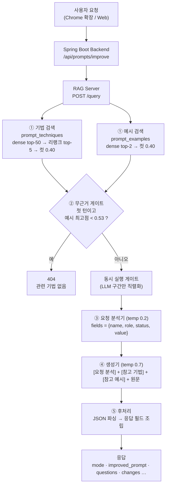

# TTALKAK 핵심 알고리즘 — 프롬프트 개선 RAG 파이프라인

> 졸업 프로젝트 발표용 정리 문서. 기준 코드: `rag-server/` (`develop` 브랜치).
> 세부 구현 기록은 [`rag-server/RAG_PIPELINE.md`](../rag-server/RAG_PIPELINE.md)·[`rag-server/WORKLOG.md`](../rag-server/WORKLOG.md)를 참고한다.
> 이 문서의 수치는 모두 위 문서와 README에 기록된 **팀 내부 평가 결과**다.

---

## 0. 한 장 요약 (발표 슬라이드용)

**해결하려는 문제** — 사용자는 "제주도 여행 블로그 글 써줘"처럼 짧고 거칠게 요청한다.
이런 요청은 LLM에서 좋은 결과가 나오지 않는다. 그렇다고 LLM에게 "프롬프트를 개선해 줘"라고만 맡기면 두 가지 실패가 생긴다.

1. **환각** — 사용자가 주지 않은 제품명·가격·스펙을 지어낸다. (예: "AirSound Pro · 30시간 · IPX4")
2. **과잉 질문** — 세부 정보가 조금만 비어도 질문만 하고 개선안을 주지 않는다.

**해결 방법** — **검색(Retrieval) → 분석(Analysis) → 생성(Generation)** 3단계 알고리즘.

| 단계 | 하는 일 | 핵심 기술 |
|---|---|---|
| ① 검색 | 요청에 맞는 **프롬프트 기법 카드**와 **유사 요청의 개선 예시**를 찾는다 | bge-m3 임베딩 + 멀티표현 max 풀링 + Cross-Encoder 리랭크 |
| ② 게이트 | 무의미한 입력(`ㅋㅋㅋ`, URL)을 생성 전에 걸러낸다 | 예시 코퍼스 기준 유사도 임계치 (AUC 1.000) |
| ③ 분석 | 요청에 필요한 정보(필드)를 **동적으로 도출**하고, 각 필드를 `required / fact / framing`으로 분류한다 | 저온(0.2) LLM + 규칙 기반 보정 |
| ④ 생성 | 분석 결과에 따라 **채워진 값은 반영, 빈 사실은 `[빈칸]`, 빈 스타일은 가정**해서 개선 프롬프트를 만든다 | 고온(0.7) LLM + JSON 구조화 출력 |
| ⑤ 후처리 | JSON을 파싱해 응답 계약(`mode`, `improved_prompt`, `questions` …)으로 조립한다 | 관대한 JSON 파싱 + 정규식 폴백 |

**핵심 성과 (내부 평가)**
- 환각 유도 평가 7개 카테고리, 18케이스를 29회 실행한 결과 **사실 창작 0건**
- 18문항 평가에서 개선안 제공 **7건 → 11건**, 환각 0건 유지
- 무의미 입력 판별 **AUC 0.575 → 1.000**
- 생성 판정 일관성 **0.23~0.75 → 0.86~1.00** (분석·생성 2단계 분리 효과)
- 리랭크 **17초 → 0.4초**, 운영 `/query` **34초 → 12초**

---

## 1. 전체 흐름



**코드 진입점**: `rag-server/app/main.py`의 `query()` → `retrieve_contexts()` → `no_evidence_gate()` → `run_generation()`

### 전체 의사코드

```text
function QUERY(req):
    history ← req.history or []

    # ① 검색 (기법·예시를 서로 다른 컬렉션에서 따로 검색)
    techniques ← SEARCH(req.query, "prompt_techniques", top_k=5, rerank=True,  min_score=0.40)
    examples   ← SEARCH(req.query, "prompt_examples",   top_k=2, rerank=False, min_score=0.40)

    # ② 무근거 게이트 (첫 턴에만)
    if history is empty and max(examples.score, default=0) < 0.53:
        return 404

    # ③~④ LLM 구간: 동시 실행 수 제한
    with GENERATION_GATE:
        analysis ← ANALYZE(req.query, history)          # 실패하면 None
        raw      ← GENERATE(req.query, techniques + examples, history, analysis)

    # ⑤ 후처리
    result ← ASSEMBLE_FIELDS(raw)                        # JSON 실패 시 정규식 폴백
    return result
```

---

## 2. 단계 ① 검색 — 2단계 검색 + 멀티표현 인덱싱

> 코드: `rag-server/app/rag/retriever.py` `Retriever.search()`

### 2-1. 코퍼스 구성 (두 컬렉션을 따로 검색)

| 컬렉션 | 내용 | 규모 | 용도 |
|---|---|---|---|
| `prompt_techniques` | 프롬프트 기법 정의 카드 (Role Prompting, Few-shot …) | 170장 (검색 대상 123장) | 생성기에 "적용할 기법"으로 제공 |
| `prompt_examples` | 한국어 "거친 요청 → 개선 프롬프트" 사례 | 131건 (19개 작업 유형) | 생성기에 "참고 예시"로 제공 + **게이트 판정** |

두 컬렉션을 한 풀에서 경쟁시키지 않는 이유: 성격이 다른 문서가 섞이면 한쪽이 상위권을 독식한다. 그래서 **타입별로 따로 검색**한 다음 생성기에 서로 다른 블록으로 넣는다.

### 2-2. 층(Layer) 필터 — 검색 대상 자격 관리

> 코드: `rag-server/app/rag/layers.py`

카드마다 층 메타데이터를 붙이고, 그중 `user_instruction` 층만 검색한다.

| 층 | 판정 질문: "이 카드를 참고해 개선 프롬프트를 만들면 결과물이 좋아지는가?" | 검색 |
|---|---|---|
| `user_instruction` | 좋아진다 (지시·구조·형식·제약·구체화) | ✅ |
| `meta` | "좋은 프롬프트를 만들어라" 자체를 말한다 (시스템이 이미 하는 일이라 동어반복) | ❌ |
| `system` | 프롬프트 문장만으로는 효과가 없다 (RAG·에이전트·모델 설정이 필요) | ❌ |
| `degenerate` | 카드에 실질적인 내용이 없다 | ❌ |

- 분류는 **LLM 분류 + 사람 검토 override** 2층 구조로 했다. (경계 사례에서 단일 LLM 판정이 흔들렸기 때문)
- 결과: top-5 노이즈 **22% → 2%**, 생성 결과에서 반영할 수 없는 기법의 비율 **29% → 0%**
- 분류되지 않은 카드는 통과시킨다. 분류 배치가 실패해도 컬렉션이 통째로 비지 않게 하기 위해서다.

### 2-3. 1단계: Dense 후보 추출 + 멀티표현 max 풀링

기법 카드 원문에는 영문 필드명(`Technique:`, `Use When:`)과 템플릿·예시가 섞여 있어서, 정작 사용자 요청과 맞아야 할 "정의/언제 쓰나" 부분의 신호가 희석된다.
그래서 **같은 카드를 축약한 "검색뷰"(이름 + 정의 + 언제 쓰나)로 한 번 더 임베딩**해 두고, 둘 중 높은 점수를 쓴다.

$$
\text{score}(q, d) = \max_{v \in \{d_{\text{full}},\ d_{\text{view}_1}, \dots\}} \cos\big(E(q), E(v)\big),
\qquad
\cos(a,b) = \frac{a \cdot b}{\lVert a \rVert\,\lVert b \rVert}
$$

- $E(\cdot)$: bge-m3 임베딩 (1024차원)
- 검색뷰가 없는 행은 본문 벡터 하나만 쓰므로 기존 동작과 같다.
- 상위 `fetch_k = 50`개를 후보로 뽑는다.

```text
function DENSE_SCORES(query, rows):
    q ← EMBED(query)
    vectors, owner ← [], []
    for i, row in rows:
        vectors.append(row.embedding);           owner.append(i)
        for v in row.embedding_views:            # 검색뷰 벡터 (없으면 생략)
            vectors.append(v);                   owner.append(i)
    sims ← COSINE(q, vectors)                    # numpy 행렬 연산 한 번
    scores[i] ← max(sims[j] for j where owner[j] = i)     # np.maximum.at
    return scores
```

| 인덱싱 방식 (dense 단독, 59문항) | Hit@1 | R@5 | nDCG@5 |
|---|---|---|---|
| 카드 전문만 (종전) | 0.576 | 0.709 | 0.634 |
| 축약뷰만 | 0.644 | 0.706 | 0.650 |
| **전문 ∪ 축약뷰 (채택)** | **0.644** | **0.723** | **0.666** |

→ 축약뷰는 정확한 1위(Hit@1)에 강하고, 전문은 템플릿에만 있는 단서를 갖고 있다. **합집합 + max**로 두 장점을 모두 취했다.
실사용형 입력 18건 중 404도 3건에서 1건으로 줄었다.

### 2-4. 2단계: Cross-Encoder 리랭크

- 후보 50개를 `(query, doc)` **쌍 단위**로 다시 채점해서 상위 `top_k = 5`를 고른다.
- Bi-encoder(임베딩)는 쿼리와 문서를 따로 벡터화하므로 빠르지만 거칠다. Cross-encoder는 쌍을 함께 보므로 느리지만 정밀하다. → **넓게 회수하고 정밀하게 재정렬하는 분업**
- 백엔드: 호스티드 리랭크 API(Jina 등)가 우선이고, 실패하면 로컬 `bge-reranker-v2-m3`로, 그것도 실패하면 dense 순위를 그대로 쓴다. **어떤 경우에도 검색이 끊기지 않는다.**

$$
p = \sigma(\text{logit}) = \frac{1}{1 + e^{-\text{logit}}}
$$

- **순위는 리랭커 점수로** 정하지만, **표시·필터용 점수는 dense 코사인**을 유지한다.
  리랭커 확률은 정답과 오답의 분포가 거의 같아서(p50 0.503 vs 0.500) 임계치로 쓸 수 없었기 때문이다.

### 2-5. 3단계: 유효 유사도 컷

$$
\text{hits} = \{\, h \in \text{top}_k \mid \text{dense\_score}(h) \ge \tau \,\},\qquad \tau = 0.40
$$

### 검색 단계 의사코드

```text
function SEARCH(query, collection, top_k, rerank, min_score):
    rows ← LOAD(collection) filtered by layer == user_instruction
    if rerank:
        cands ← top-50 of DENSE_SCORES(query, rows)
        try:    hits ← top_k of RERANK(query, cands)       # 순위 = 리랭커
        except: hits ← cands[:top_k]                       # 폴백
    else:
        hits ← top_k of DENSE_SCORES(query, rows)
    return [h for h in hits if h.dense_score ≥ min_score]
```

### 측정으로 결정한 것 · 기각한 것

| 결정 | 근거 |
|---|---|
| 리랭커 유지 | 기존 평가셋 R@5 +4.0%p, 어려운 커버리지 평가셋 **+12.3%p** |
| `fetch_k` 20 → 50 | 쉬운 구간 손실 0, 어려운 구간 R@5 +5.3%p (지연만 2.0s → 4.5s) |
| 벡터 DB 대신 MySQL brute-force | 수백 청크 규모에서 코사인 계산은 약 1ms. Backend와 같은 DB를 써서 인프라를 줄였다 |
| ❌ HyDE (가상 문서로 쿼리 확장) | R@5 **0.763 → 0.441**. 쿼리를 카드 문체로 바꾸면서 범용 카드가 잘못 회수됐다 |
| ❌ BM25 하이브리드 | 한국어 형태소 BM25도 −7.0%p |
| ❌ doc2query (문서 쪽 예상 질문 생성) | Hit@1 0.610 → 0.220. 예문이 기법이 아니라 **소재**로 매칭됐다 |

---

## 3. 단계 ② 무근거 게이트 — "판정 주체를 바꾼" 알고리즘

> 코드: `rag-server/app/core/gate.py` `no_evidence_gate()`

**문제**: 원래는 "기법 카드가 0건이면 404"였다. 그런데

- `https://example.com`(0.538) 같은 무의미한 입력은 **통과**했고
- "제주도 여행 블로그 글 써줘. 아이랑 3박4일"(0.361) 같은 정상 요청은 **404**가 났다.

정상 요청의 최저점(0.336)이 무관 입력의 최고점(0.538)보다 낮아서, **어떤 임계치로도 둘을 분리할 수 없었다.**

**원인 규명**: 문제는 임계치가 아니라 **코퍼스의 문체**였다.
기법 카드는 영어 정의문체이고 사용자 입력은 한국어 구어체라서, 의미가 아니라 표면 형태로 매칭되고 있었다.

| 판정 기준 컬렉션 | 관련/무관 분리 AUC |
|---|---|
| `prompt_techniques` (영문 정의체) | 0.575 ~ 0.694 (거의 무작위) |
| `prompt_examples` (사용자 말투의 한국어) | **1.000 (완전 분리)** |

**해결**: 판정 기준을 사용자와 같은 말투로 쓰인 **예시 코퍼스**로 옮겼다.

```text
function NO_EVIDENCE_GATE(techniques, examples, history, θ = 0.53, examples_ok):
    if history is not empty:            return PASS     # 후속 턴은 대화 맥락으로 잇는다
    if θ > 0 and examples_ok:
        best ← max(e.score for e in examples, default = 0)
        return BLOCK if best < θ else PASS
    return BLOCK if techniques is empty else PASS       # 예시 검색 실패 시 종전 규칙으로 폴백
```

**안전장치**
- 예시 검색이 **예외로 실패**한 경우 "예시 0건"과 구분해서 기법 기준으로 폴백한다. 인프라 장애를 무의미 입력으로 오판하지 않기 위해서다.
- 예시 코퍼스가 **비어 있는** 배포 환경에서도 정상 요청이 전부 404가 되지 않게 막는다.
- 게이트를 통과한 애매한 입력은 생성 단계의 `mode = "ask"`(되묻기)가 한 번 더 걸러낸다.

---

## 4. 단계 ③ 요청 분석기 — 필드 동적 도출 + 3역할 분류

> 코드: `rag-server/app/rag/analyzer.py` `analyze()`

### 4-1. 왜 분석과 생성을 나눴나

분석은 **결정적**이어야 하고(같은 입력이면 같은 판정), 생성은 **자연스러워야** 한다. 두 작업의 최적 온도가 정반대다.

| 구성 | 판정 일관성 |
|---|---|
| 한 번의 호출로 분석과 생성을 같이 | 0.23 ~ 0.75 |
| **분석(temp 0.2) → 생성(temp 0.7) 분리** | **0.86 ~ 1.00** |

### 4-2. 출력 구조

```json
{
  "taskType": "제품 소개 글",
  "fields": [
    {"name": "제품",        "role": "required", "status": "filled", "value": "신제품 무선 이어폰"},
    {"name": "제품명",      "role": "fact",     "status": "empty",  "value": null},
    {"name": "배터리 시간", "role": "fact",     "status": "empty",  "value": null},
    {"name": "톤",          "role": "framing",  "status": "empty",  "value": null}
  ]
}
```

필드는 고정된 표가 아니라 **요청마다 LLM이 동적으로 도출**한다.

### 4-3. 3가지 역할 (이 알고리즘의 핵심 아이디어)

| 역할 | 정의 | 비어 있으면 생성기는 |
|---|---|---|
| `required` | 비면 "무엇을 만드는지"조차 정해지지 않음 (주제, 용건, 원문 등) | **되묻는다** (`mode = ask`) |
| `fact` | 지어내면 **거짓**이 되는 구체값 (날짜·가격·스펙·고유명사·수치) | **`[항목명 입력]` 빈칸** + 선택 질문 |
| `framing` | 비어도 **합리적으로 가정**할 수 있음 (톤·대상 독자·분량·형식) | **가정**하고 `changes`에 명시 |

> 판별 기준: *"그 값이 틀리면 사용자가 '그건 사실이 아닌데'라고 할까?"* → 그렇다면 `fact`

이 분류 덕분에 **환각(fact를 지어냄)** 과 **과잉 질문(framing까지 물어봄)** 을 동시에 막을 수 있다.

### 4-4. LLM 출력 보정 규칙 (규칙 기반 후처리)

LLM 판정을 그대로 믿지 않고 코드로 보정한다. 각 규칙은 실측으로 발견한 오류 패턴에서 나왔다.

```text
function ANALYZE(query, history):
    msg ← query + (최근 대화 4턴 if history)          # 이전 턴에서 답한 값은 filled로 잡힌다
    data ← LLM(SYSTEM_ANALYZER, msg, temp=0.2)
    if 호출/파싱 실패: return None                     # 생성기는 분석 없이 진행 (무회귀)

    fields ← SANITIZE(data.fields)
        · "포함 내용" 같은 만능 필드 제거                # 항상 required+empty로 잡혀 강제 ask 유발
        · 톤·대상 독자·분량·형식은 무조건 framing으로 교정
        · 알 수 없는 role은 framing (가장 안전한 쪽)
        · required는 최대 2개, 초과분은 fact로 강등

    fields ← EXEMPT_TEMPLATE_SOURCE(query, fields)
        # "~하는 프롬프트 만들어줘" (템플릿 요청) → 빈 원문 required를 fact로 강등
        # 원문이 없어도 [원문 붙여넣기] 빈칸을 둔 지시문을 만들 수 있기 때문

    fields ← REQUIRE_REFERENCED_SOURCE(query, fields)
        # "이 이메일 번역해줘" (가리켰지만 붙여넣지 않음) → 빈 원문 fact를 required로 승격
        # 실측: 되묻기 유지율 4/7 → 14/14

    fields ← DROP_IMPLEMENT_FIELD_FOR_REVIEW(query, fields)
        # 코드 '리뷰' 요청에 '구현할 기능'을 요구하던 오류 → fact로 강등
        # 단, 가리킨 코드가 없는 리뷰("이 함수 버그 찾아줘")는 제외 → 우선순위: 가리킴 > 리뷰

    return {taskType, fields, templateRequest}
```

**멀티턴 처리**: 매 턴 최근 대화를 함께 넣어 필드 상태를 다시 구성한다. 이전 턴에서 답한 항목은 `filled`가 되므로 **같은 질문을 반복하지 않는다.**

---

## 5. 단계 ④ 생성기 — 하이브리드 응답 (개선안 + 빈칸 + 선택 질문)

> 코드: `rag-server/app/rag/generator.py` `Generator.generate()`, `build_analysis_block()`

### 5-1. 분석 결과를 생성 지시로 변환

```text
function BUILD_ANALYSIS_BLOCK(analysis):
    for f in analysis.fields:
        if f.status == filled:                 emit "{name} = {value}"             → 재료로 반영
        elif template and f is 원문 필드:      emit "[template] 빈칸 두고 개선 모드"
        elif f.role == fact:                   emit "[fact] 없음 → [{name} 입력] 빈칸 + 질문"
        elif f.role == required:               emit "[required] 원문 재확인 → 정말 없을 때만 질문"
        else:                                  emit "[framing] 없음 → 가정하고 changes에 명시"
```

`required`가 비었을 때도 생성기에 "원문을 다시 확인하라"고 맡긴다. 분석기가 놓친 값을, 원문 전체를 보는 생성기가 바로잡을 수 있게 **2중 판정**을 한 것이다.

### 5-2. 생성기 입력 조립

```text
[요청 분석]        ← 분석기 결과 (필드별 처리 지시)
[참고 기법]        ← 검색된 기법 카드 ≤5개 (유사도 포함)
[참고 예시]        ← 유사 요청의 개선 사례 ≤2개
[원본 프롬프트]    ← 사용자 원문 (검색용으로 변형하지 않은 원본)
+ 대화 기록 (최근 6,000자 예산, 오래된 턴부터 버림, 턴 내용은 자르지 않음)
```

### 5-3. 모드 결정 규칙 — "기본은 개선, 질문은 예외"

```text
(A) 작업 종류  — 무엇을 시키는가 (글쓰기 / 코드 / 요약 / 번역 …)
(B) 핵심 주제  — 무엇에 대한 것인가

if (A)와 (B)가 모두 특정됨:
    mode ← "improve"
    improved_prompt ← 지시문 (filled = 반영, fact = [빈칸], framing = 가정)
    questions ← 빈칸마다 선택 질문 1개 (importance = recommended, 최대 3개)
else:
    mode ← "ask"
    questions ← 핵심 질문 1~3개 (importance = required)
```

**하이브리드 설계 (규약 v3)**: 예전에는 개선안과 질문이 배타적(XOR)이어서, 세부가 조금만 비어도 질문 모드로 빠졌다.
지금은 **개선안은 바로 실행할 수 있고, 질문은 빈칸을 채우기 위한 선택 사항**이다. 빈칸과 질문은 `field` 이름으로 1:1로 연결된다.

### 5-4. 안전 규칙 (환각 방지)

| 규칙 | 내용 |
|---|---|
| 사실 창작 금지 | 사용자가 주지 않은 구체 사실은 `[항목명 입력]` 빈칸으로 남긴다 |
| 원문 그대로 보존 | 사용자가 붙여넣은 원문(회의록·코드·번역 대상)은 **그대로 전부** 지시문 안에 넣는다 (빈칸 금지) |
| 결과물 직접 작성 금지 | 출력은 항상 "AI에게 ~하라"는 **지시문**이지, 완성된 글이 아니다 |

**Before / After 예시** (동작을 설명하기 위해 단순화한 예시)

```text
입력:  "신제품 무선 이어폰 소개 글 써줘"

❌ 일반 LLM:  "AirSound Pro는 최대 30시간 재생, IPX4 방수를 지원하는…"   ← 환각

✅ TTALKAK:  "너는 IT 제품 마케팅 카피라이터다. 아래 정보를 바탕으로
              신제품 무선 이어폰 소개 글을 작성하라.
              - 제품명: [제품명 입력]
              - 주요 스펙: [배터리 시간·방수 등급 입력]
              - 톤: 친근하고 신뢰감 있는 톤 …"
             + 선택 질문: "제품명이 무엇인가요?", "배터리 시간은 몇 시간인가요?"
```

### 5-5. 백엔드 라우팅과 폴백

```text
function GENERATE(query, contexts, history, analysis):
    backend ← PRIMARY (환경변수 GEN_PRIMARY: gemini | groq)
    if backend == groq and NEEDS_LONG_CONTEXT(...):    # 원문을 그대로 다시 출력할 예산이 부족하면
        backend ← gemini                               # 컨텍스트가 큰 쪽으로 라우팅
    try:
        return backend.generate(...)                   # JSON 출력 강제
    except RuntimeError:
        return OTHER_BACKEND.generate(...)             # 1회 폴백
```

- 출력 토큰 상한은 **TPM 예산 안에서 동적으로 계산**한다: `max_tokens = clamp(TPM − 입력추정 − 200, 512, 4096)`
- 추론 모델이 JSON을 쓰기 전에 출력 예산을 다 써 버리면, 그 요청만 추론량을 낮춰(`reasoning_effort = low`) 한 번 재시도한다.
- 현재 운영 모델 조합: **생성 Gemini 3.6 Flash · 분석 Gemini 3.5 Flash-Lite** (요청당 약 $0.01, 분석 비용은 전체의 약 10%)

---

## 6. 단계 ⑤ 후처리 — 구조화 JSON 우선, 정규식은 폴백

> 코드: `rag-server/app/rag/postprocess.py` `assemble_fields()` (순수 함수 — LLM 없이 단위 테스트 가능)

```text
function ASSEMBLE_FIELDS(raw):
    p ← PARSE_JSON_LENIENT(raw)                 # 코드펜스나 앞뒤 잡담이 있어도 허용
    if p is valid:
        return { mode, improved_prompt, techniques, changes, score,
                 summary, questions(객체 배열로 정규화), answer = 마크다운 복원 }
    else:                                       # 모델이 JSON을 지키지 않아도 서비스는 계속된다
        improved ← REGEX_EXTRACT(raw)
        return { mode = "improve" if improved else "ask", answer = raw, questions = [] }
```

**응답 계약**: 프론트엔드는 추측하지 않고 **`mode` 하나로만 분기**한다.

| `mode` | 화면 |
|---|---|
| `improve` | `improved_prompt` 표시 + 실행(Execute) 버튼 + (있으면) 선택 질문 |
| `ask` | `questions[]` 표시, 실행 버튼 숨김 |

---

## 7. 운영 안정성 알고리즘 — 동시 실행 게이트

> 코드: `rag-server/app/core/concurrency.py` `Gate`

**문제**: 무료 티어에서는 요청 1건이 LLM의 분당 토큰 한도(TPM 8,000)의 약 7,800을 쓴다. 동시에 2건이 오면 두 번째는 반드시 429가 나고, 폴백 백엔드의 일일 한도까지 소진되어 서비스 전체가 멈췄다.

**해결**: **LLM 구간만** 세마포어로 감싸서 동시 실행 수를 제한하고, 대기열과 대기 시간에 상한을 둔다.

```text
function ENTER_GATE():
    if semaphore.try_acquire():               return RUN          # 빈 슬롯이 있으면 바로 실행
    if waiting ≥ QUEUE_DEPTH (2):             raise 503 + Retry-After: 30   # 줄이 꽉 참 → 즉시 거절
    waiting += 1
    ok ← semaphore.acquire(timeout = 40s)
    waiting -= 1
    if not ok:                                raise 503 + Retry-After: 30   # 대기 시간 초과
    return RUN
```

**파라미터 관계**: `대기 상한 ≈ 대기열 길이 × 1건 처리 시간` (2 × 20초 ≈ 40초).
여기에 검색(~5초)과 생성(~20초)을 더해도 Backend 타임아웃 75초 안에 들어오도록 맞췄다.

- 검색·리랭크는 게이트 **밖**에서 병렬로 처리한다. 게이트 안에 넣으면 처리량이 절반으로 줄어든다.
- 동시성 기본값은 메인 백엔드에 맞춘다. 유료 Gemini는 6, 무료 Groq는 1이다.
- `Retry-After` 헤더는 Backend와 CORS 설정을 거쳐 프론트엔드까지 전달된다.

---

## 8. 시간 복잡도

| 단계 | 복잡도 | 실측 |
|---|---|---|
| 쿼리 임베딩 | $O(L)$ (L = 쿼리 길이, 모델 1회 추론) | — |
| Dense 전수 코사인 | $O(N \cdot V \cdot d)$ — N=청크 수, V=청크당 벡터 수(1~2), d=1024 | 약 1ms (수백 청크) |
| 컬렉션 로드 (DB + JSON 파싱) | $O(N \cdot d)$ | 약 236ms |
| 리랭크 | $O(k_{\text{fetch}})$ 쌍 추론, $k_{\text{fetch}} = 50$ | 호스티드 API 0.4초 (로컬 CPU 17초) |
| 분석 + 생성 LLM | API 호출 2회 | 전체 지연의 대부분 |
| **`/query` 전체 (운영)** | | **약 12초** (개선 전 34초) |

> 확장성 한계: 코퍼스가 수천~수만 청크로 커지면 전수 스캔이 병목이 된다. 그때는 ANN 인덱스나 캐시 도입이 필요하다. (현재 규모에서는 별도 벡터 DB가 오히려 운영 부담)

---

## 9. 평가 체계

검색, 생성, 실제 효용을 **분리해서** 측정한다. "개선 프롬프트가 좋아 보인다"와 "그 프롬프트로 만든 결과물이 실제로 좋아진다"는 다른 질문이기 때문이다.

| 평가 | 대상 | 지표 | 도구 |
|---|---|---|---|
| 검색 | 기법 카드 회수 | Hit@1, Recall@k, nDCG@5, MRR | `eval/run_eval.py` |
| 생성 | 개선 프롬프트 품질 | LLM judge 점수, mode 판정 정확도 | `eval/gen_eval.py` |
| 결과 상향 | 원본 vs 개선 프롬프트로 만든 결과물 A/B | 승률, 평균 점수 차 (**순서를 바꿔 위치 편향 제거**) | `eval/uplift_eval.py` |
| 환각 | 지어내고 싶게 유도하는 입력 | 사실 창작 발생률 | `eval/halluc_eval.py` |
| 게이트 | 무의미 입력 판별 | AUC | `eval/gate_eval.py` |

- 커버리지 평가셋 54문항을 추가해서, 평가가 다루는 검색 대상 카드를 **50% → 94%**로 넓혔다.
- 운영과 평가가 **같은 코드 경로**(`retrieve_contexts()`, `run_generation()`)를 쓴다. 측정한 것이 곧 운영되는 것이다.

---

## 10. 발표 예상 질문 & 답변

**Q1. 그냥 ChatGPT에 "프롬프트 개선해줘"라고 하면 되지 않나요?**
A. 그렇게 하면 두 가지 실패가 생깁니다. 정보가 부족하면 제품명이나 스펙을 지어내고(환각), 반대로 신중하게 만들면 질문만 하고 개선안을 주지 않습니다. 저희는 요청을 먼저 분석해서 필드를 `required / fact / framing`으로 나누고, 역할마다 처리 방식을 다르게 해서 둘을 동시에 해결했습니다. 그 결과 환각 0건을 유지하면서 개선안 제공은 7건에서 11건으로 늘었습니다.

**Q2. 왜 별도의 벡터 DB를 쓰지 않았나요?**
A. 현재 코퍼스는 수백 청크 규모라서 numpy 전수 코사인 계산이 약 1ms면 끝납니다. Backend와 같은 MySQL을 공유하면 인프라가 하나 줄어듭니다. 대신 코퍼스가 커지면 ANN 인덱스를 도입해야 한다는 한계를 문서에 남겨 두었습니다.

**Q3. 리랭커가 그렇게 느린데 왜 유지했나요?**
A. 어려운 문항이 포함된 평가셋에서 Recall@5가 12.3%p 올랐습니다. 대신 속도 문제는 호스티드 리랭크 API로 해결했습니다(17초 → 0.4초). LLM judge A/B로 품질 손실이 노이즈 수준임을 확인했고, API가 실패하면 로컬 모델로 폴백합니다.

**Q4. HyDE 같은 최신 기법은 왜 쓰지 않았나요?**
A. 실제로 적용해서 측정했는데 Recall@5가 0.763에서 0.441로 크게 떨어졌습니다. 쿼리를 기법 카드 문체로 재작성하는 과정에서 범용 카드가 잘못 회수됐습니다. BM25 하이브리드와 doc2query도 같은 방식으로 측정한 뒤 기각했고, 그 수치를 모두 기록해 두었습니다.

**Q5. 무의미한 입력은 어떻게 걸러내나요?**
A. 처음에는 기법 카드와의 유사도로 판정했지만 AUC가 0.575로 거의 무작위였습니다. 원인을 분석해 보니 임계치가 아니라 **코퍼스 문체**(영어 정의문체 vs 한국어 구어체)의 문제였습니다. 그래서 판정 기준을 사용자 말투로 쓰인 예시 코퍼스로 옮겼고, AUC 1.000을 얻었습니다. (단, 양성·음성 24건의 소표본 기준이라 표본을 늘려 재교정할 예정입니다.)

**Q6. 왜 LLM을 두 번 호출하나요? 비용이 늘지 않나요?**
A. 분석은 결정적이어야 하고 생성은 자연스러워야 해서 최적 온도가 반대입니다. 한 번에 처리하면 판정 일관성이 0.23~0.75였는데, 분리하니 0.86~1.00이 되었습니다. 분석은 저가 모델(Flash-Lite)에 맡겨서 전체 비용의 약 10%만 차지합니다.

**Q7. 여러 사람이 동시에 쓰면 어떻게 되나요?**
A. LLM 구간에만 동시 실행 게이트를 두었습니다. 슬롯이 없으면 제한된 시간 동안 줄을 서고, 대기열이 꽉 차면 즉시 503과 `Retry-After`를 돌려줍니다. 한도 초과(429)로 실패해서 폴백 쿼터까지 태우는 것보다, 줄을 세워 성공시키는 편이 낫다고 판단했습니다.

---

## 부록. 주요 파라미터

| 파라미터 | 값 | 위치 |
|---|---|---|
| 임베딩 모델 | `BAAI/bge-m3` (1024차원) | `app/core/embeddings.py` |
| 리랭커 | 호스티드 API (Jina 등) → 로컬 `bge-reranker-v2-m3` 폴백 | `app/core/rerank.py` |
| `fetch_k` (1단계 후보 수) | 50 | `app/main.py` |
| `top_k` (최종 기법 수) | 5 | `QueryRequest` |
| `min_score` (기법 유사도 컷) | 0.40 | `QueryRequest` |
| `n_examples` / `example_min_score` | 2 / 0.40 | `QueryRequest` |
| `gate_min_score` (무근거 게이트) | 0.53 (`RAG_GATE_MIN_SCORE`) | `app/core/gate.py` |
| 분석기 온도 | 0.2 | `app/rag/analyzer.py` |
| 생성기 온도 | 0.7 (`GEN_TEMPERATURE`) | `app/rag/generator.py` |
| 대화 기록 예산 | 6,000자 | `app/rag/generator.py` |
| 동시 실행 / 대기열 / 대기 시간 | Gemini 6 · Groq 1 / 2 / 40초 | `app/core/concurrency.py` |
